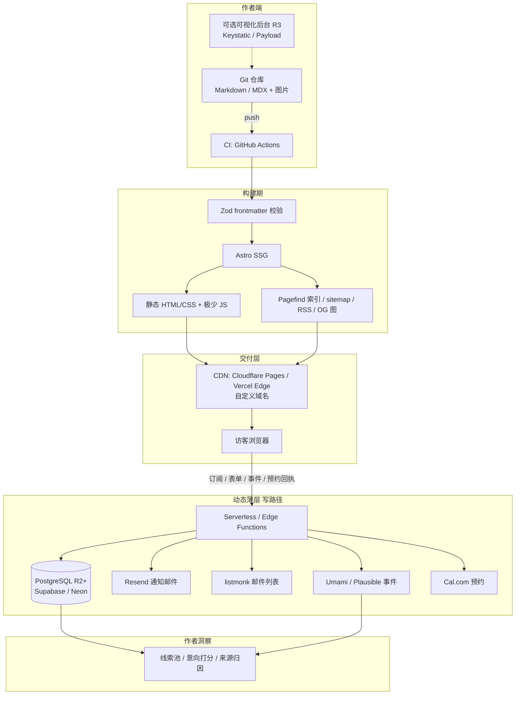
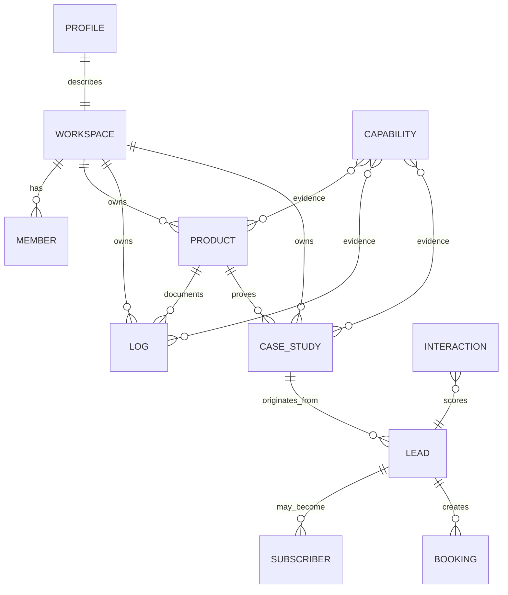
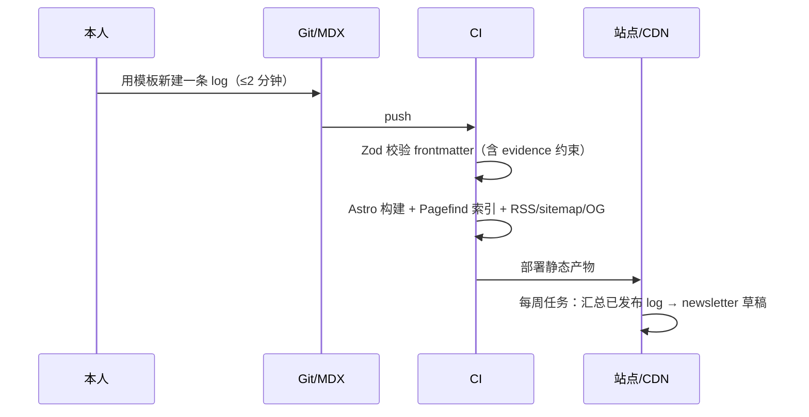
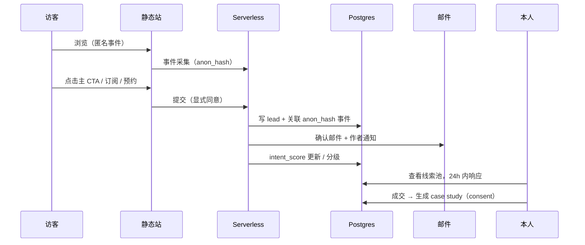

# 产品分析与概要设计文档

> **项目工作代号**：Atelier / 造物间（暂定，非最终品牌名）
> **阶段**：第一阶段 · 产品概念确立（讨论稿 v0.1）
> **日期**：2026-11-12
> **定位**：本文是**概念确立与决策依据**，不是实施规格说明书。文中标注 `[待确认]` 的条目需要在进入开发前由发起人拍板，见第 7 节。
> **事实口径**：竞品的许可证、仓库名等客观信息已通过 GitHub API / 官网核验（快照时间 2026-11-11 ~ 11-12），Star 数仅作社区活跃度参考；定价、额度等随时间变化，本文只描述**模式与量级**，不写死数字，落地前需复核。来源见附录 A。

---

## 0. 阅读指引

| 读者角色 | 建议先读 |
| --- | --- |
| 发起人 / 决策者 | 1 执行摘要 → 2.3 产品概念 → 4.5 差距结论 → 5.8 指标 → 7 决策清单 |
| 后续开发负责人 | 5 概要设计 → 6 技术栈 → 3.3 功能规格 |
| 设计 / 内容负责人 | 2.2 关键矛盾 → 5.2 信息架构 → 3.3 前台规格 |

---

## 1. 执行摘要（结论先行）

**一句话结论**：用户描述的不是"个人网站 + 博客"，而是一个**以作品为证据、以创作过程建立信任、以线索转化为闭环、可随组织形态生长的个人商业主页**。市场上没有单一现成产品同时满足这四件事，但**约 90% 的能力有成熟开源/现成组件可复用**，真正需要自研的只是很薄的一层：**统一内容模型 + 前台信息架构 + 转化闭环 + 预留组织化的数据结构**。

**五个核心判断**：

1. **目标不是流量，是"合格线索"**。原需求里"发现潜在用户 / 服务对象 → 转化成长久客户"是一条营销漏斗，博客和作品集模板都不带漏斗概念。因此必须引入线索识别、意向信号、CTA、留资与回访机制，北极星指标应是**每月合格线索数**而非 PV。
2. **"一目了然"与"记录创作过程"是结构性矛盾**。"过程"天然冗长、面向同行；"一目了然"面向普通访客、要求 3 秒读懂。解法不是折中，而是**分层披露**：3 秒 / 30 秒 / 3 分钟三层，首屏设硬性信息预算（见 5.2）。
3. **"技能专长"不能写成标签云，必须写成"证据链"**。建议定为产品级规则：不写"精通 X"，写"用 X 做了 Y，结果是 Z"，每条能力挂到具体作品 / 日志 / 案例上。这是独立开发者建立可信度最有效、也最被现有模板忽略的一点。
4. **"以后组建团队/公司"不是未来才考虑的事**，而是**现在就要在数据模型里埋 3 个字段**（workspace、member、role）。v1 的 UI 完全可以是单人，但 schema 若硬编码单用户，R3 迁移会重写全部业务语义。这是低成本、高回报的架构决策。
5. **最大风险不是技术，是"弃更"**。独立开发者自建内容平台最常见的死法是发布摩擦太高、两周后停更。因此架构上必须让"记一条"比"发一条朋友圈"更轻，并把记录嵌入开发流程（changelog / commit / 发布自动聚合），而不是额外增加一项负担。

**推荐路线**：`Astro 静态站 + Git/MDX 内容` 起步（读路径全静态、写路径 Serverless），先用 2~3 周做 R1 上线验证，再按线索数据决定是否追加 R2 动态能力；若确需多人在线协作，再迁移到 `Next.js + Payload + PostgreSQL`。**先自用（dogfooding），验证后再考虑把它本身做成产品卖给其他独立开发者**（见 7.1 的关键分叉）。

---

## 2. 需求解读与产品概念抽象

### 2.1 原始诉求逐句拆解

把发起人的描述拆成可验证的命题，并暴露隐含要求：

| # | 原话（要点） | 表层理解 | 隐含的真实要求 / 被忽略的约束 |
| --- | --- | --- | --- |
| A | "记录自己的创作过程和结果" | 写博客 | **两种不同内容**：过程（devlog / 决策 / 复盘 / changelog，高频、碎片、面向同行）与结果（作品 / 案例 / 发布物，低频、结构化、面向客户）。二者受众、节奏、生命周期都不同，不能用一种"文章"模型硬装 |
| B | "展示给普通访问者快速认识我、我的产品及我的技能专长和能力" | 做个人主页 | **受众是"普通访问者"，不是开发者**。技术化的 devlog 对普通人是噪音；需要"3 秒看懂你是谁 / 做过什么 / 能帮我什么 / 怎么联系" |
| C | "在流量中发现潜在用户、或服务对象" | 加统计 | 需要**意向信号识别**：谁看了定价/服务页、谁重复访问、谁读了深度内容、从哪个渠道来。匿名 PV 报表回答不了"谁是潜在客户" |
| D | "进一步转化成长久客户" | 放个联系方式 | 需要**转化漏斗与留存**：CTA → 留资/订阅/预约 → 跟进 → 成交 → 案例回流。以及唯一真正可迁移的受众资产：**自有邮件列表** |
| E | "业务发展且扩大，可以组建团队或公司" | 以后再说 | 需要**内容归属、多作者、角色权限、多品牌/组织**的扩展位；且意味着这套东西可能从"个人工具"变成"组织资产"甚至"对外产品" |
| F | "基于 Web 的网站或应用服务，类似个人网站和博客的结合体" | 技术选型假设 | 这是**解决方案假设**，不是需求。真正需求是 A~E；"博客"是其中最弱的一环（无结构化、无转化） |
| G | "尽量做到简洁、一目了然" | 视觉风格 | 这是**硬约束**，同时约束前台信息密度、后台写作流程、以及功能范围（必须敢于砍功能） |

**由此浮现的四个张力**（产品设计的真正题眼）：

- **T1 过程 vs 结果**：高频碎片 vs 低频精品 → 统一内容模型 + 不同展示位
- **T2 深度 vs 一目了然**：同行想看细节，客户只想看结论 → 分层披露
- **T3 表达 vs 转化**："记录自己"是内向动机，"找客户"是外向目标 → 每个内容块都要有下一步动作（CTA）
- **T4 极简 vs 可生长**：今天一个人要轻，明天一个团队要全 → schema 预留、UI 按需展开

### 2.2 关键矛盾与取舍原则

| 矛盾 | 取舍 | 理由 |
| --- | --- | --- |
| 全公开创作过程 vs 只展示精选 | **默认公开"过程摘要"，细节可折叠；敏感项（收入、客户信息、未发布想法）默认私有** | 过程公开是信任杠杆，但独立开发者常有保密/竞业约束；给一个 `visibility` 字段比事后补救便宜 |
| 静态站 vs 动态应用 | **读路径全静态，写路径才动态** | 90% 的请求是读。静态 = 极快、极稳、极便宜、无数据库运维、天然抗流量峰值，且完全契合"一目了然" |
| 自研 vs 拼装 | **复用成熟组件，自研"薄层"** | 见 4.5。自研 CMS / 评论 / 邮件队列 / 分析都是负收益 |
| 可视化后台 vs Git/Markdown | **v1 用 Git/MDX，后台作为可选插件** | 作者本身是开发者，Git 即版本历史 + 备份 + 内容主权；可视化后台会引入数据库与运维，与 R1 目标冲突 |
| 现在做多租户 vs 以后再说 | **不做多租户功能，但做多租户数据模型** | 3 个字段的成本，换来 R3 不重写 |

### 2.3 产品概念定义

> **概念**：一个「**以作品为证据、以创作过程建立信任、以线索转化为闭环**」的**成长型个人商业主页**。
> 对陌生访客它一目了然；对本人是内容资产与客户资产的沉淀；对未来的团队/公司，它是一套不需要推倒重来的数据底座。

**不是什么**（划清边界，比"是什么"更能防止范围蔓延）：

- ❌ 不是通用 CMS / 博客系统（不与 WordPress、Ghost 竞争）
- ❌ 不是社交网络 / 社区（不做关注、信息流、点赞）
- ❌ 不是完整 CRM / 销售自动化（线索池只做到"够用"）
- ❌ 不是作品集模板市场（主题只是皮肤）
- ❌ v1 不是面向他人的 SaaS 多租户产品（但 schema 不封堵这条路）
- ❌ 不是简历 / Linktree 聚合页（那些只有"链接"，没有"证据"和"转化"）

**一个中心、两条线、一个闭环**：

```
                    ┌──────────────────────────┐
                    │   中心：身份与信任 (Identity)  │
                    │  我是谁 · 我做什么 · 能帮你什么  │
                    └────────────┬─────────────┘
                                 │
              ┌──────────────────┴──────────────────┐
              │                                     │
      ┌───────▼────────┐                  ┌────────▼───────┐
      │  结果线 (Proof)  │                  │  过程线 (Making) │
      │ 作品 / 案例 / 能力│◄── 证据挂接 ──►│ 日志 / 决策 / 复盘│
      │   低频 · 结构化   │                  │   高频 · 碎片化   │
      └───────┬────────┘                  └────────┬───────┘
              └──────────────────┬──────────────────┘
                                 │
                    ┌────────────▼─────────────┐
                    │  闭环：触达→理解→证据→意向→线索→客户→口碑 │
                    └──────────────────────────┘
```

**三个视角的产品定义**：

| 视角 | 它是什么 | 成功长什么样 |
| --- | --- | --- |
| 访客 | 一张"会说话的名片" | 3 秒知道值不值得继续看，30 秒找到想找的证据 |
| 本人 | 创作台账 + 客户线索池 | 每周能无负担地记东西，并从后台看到"谁可能要买" |
| 未来组织 | 团队/公司的内容与关系底座 | 加人、加品牌、加审核流时不用迁移数据语义 |

**命名候选**（工作代号，最终品牌名留待后续决策）：

| 候选 | 意象 | 适配度 |
| --- | --- | --- |
| **Atelier / 造物间**（推荐） | 个人作坊 → 工作室 → 公司，天然覆盖"过程 + 作品 + 成长" | 高，且与"组建团队"叙事一致 |
| Proof / 印证 | 强调"作品即证据" | 中，偏冷、偏同行 |
| Made & Making / 造物志 | 同时表达"已做"与"在做" | 中高，中文语感好 |

### 2.4 用户与场景（JTBD）

| 角色 | Jobs To Be Done | 关键诉求 | 设计响应 |
| --- | --- | --- | --- |
| **P0 本人（独立开发者）** | "把做过的东西和过程沉淀下来，别让它们散在 commit、朋友圈和聊天记录里" | 低摩擦记录、内容主权、可迁移 | Git/MDX、短内容类型、changelog 自动聚合、一键导出 |
| **P1 普通访问者（陌生人）** | "这人是谁？做过什么？跟我有关系吗？" | 一目了然、不迷路 | 首屏信息预算、三层披露、清晰导航 |
| **P1 潜在客户 / 服务对象** | "他能不能解决我的问题？靠谱吗？怎么联系 / 怎么合作？" | 可信证据、明确服务边界、低摩擦联系 | 案例与量化结果、能力证据链、服务/定价页、预约与订阅 CTA |
| **P2 同行 / 社区** | "他怎么做到的？有没有可复用的经验？" | 过程细节、技术深度 | devlog / ADR-lite / 复盘、RSS、评论 |
| **P3 未来团队成员** | "我能不能一起写、一起管？" | 角色、审核、归属 | R3：member / role / 审核流 |

**典型场景**：
- S1 访客从社区帖子点进来 → 首屏 3 秒判断"是做 XX 工具的独立开发者" → 点开 1 个作品 → 看 1 篇构建日志 → 点"聊聊你的项目"留资 → 进入线索池
- S2 本人上线一个小版本 → `git commit` + 一条 3 行 changelog → 自动进 /log、自动进 RSS、每周自动汇总成邮件 → 订阅者回流 → 其中一人成为客户
- S3 客户合作完成 → 生成 case study（脱敏 + 授权）→ 挂回对应作品与能力 → 成为下一个访客的证据（闭环回流）

### 2.5 设计原则（写进工程约束，不只是口号）

1. **首屏预算制**：首屏只允许出现有限个元素，超出即砍（具体见 5.2）。
2. **证据优先于形容词**：任何能力声明必须可点击到证据。
3. **静态优先**：能用构建期解决的，不用运行时；能用运行时无状态解决的，不引入数据库。
4. **内容为文件**：Markdown/MDX 是唯一真相源，平台可替换、内容不锁死。
5. **每块内容都有下一步**：作品 → 试用/案例；日志 → 订阅；能力 → 约聊。
6. **隐私默认**：无 cookie 分析、不采集无关 PII、留资明示同意、可删除。
7. **模型先行、功能后置**：组织化字段从 R1 就在，功能到 R3 才开。
8. **发布摩擦最小化**：记一条 ≤ 2 分钟，允许"不完美"的短内容。

---

## 3. 功能描述：扩展与修订

### 3.1 功能全景（按 MUST / SHOULD / COULD / WON'T 分层）

| 层 | 功能 | 归属版本 |
| --- | --- | --- |
| **MUST** | 首屏身份/价值主张；作品结构化展示；能力证据链；创作日志（多类型）；关于/近况页；内容模型与 MDX 写作流；RSS / sitemap / OG / SEO；隐私友好分析；至少 2 个 CTA（订阅 + 联系/预约）；内容主权与导出 | R1 |
| **SHOULD** | 站内搜索；评论；案例/客户评价；服务与定价页；线索池与意向打分；邮件列表与自动周刊；来源/UTM 归因；多语言骨架 | R2 |
| **COULD** | 多成员与角色；审核/发布流；多品牌 workspace；在线可视化后台；付费/数字商品下载；公开数据页（build in public 的指标） | R3 |
| **WON'T（v1 明确不做）** | 社交关系（关注/信息流/点赞）、通用页面拖拽搭建器、完整 CRM/销售自动化、自研评论与邮件队列、移动端原生 App、多租户计费后台 | — |

### 3.2 对原始功能描述的修订对照表

| 原描述 | 修订后的表述 | 修订理由 |
| --- | --- | --- |
| "个人网站和博客的结合体" | "**结构化作品集 + 创作日志 + 转化型落地页** 三合一；博客降级为其中一种内容类型" | 博客无结构化字段、无转化路径，无法承载"作品/能力"和"找客户" |
| "记录创作过程和结果" | 拆为两类实体：**`log`（6 种子类型）** 与 **`product` / `case_study`**，二者双向关联 | 受众、节奏、生命周期不同；关联后才能形成"证据链" |
| "展示技能专长和能力" | 改为 **能力证据链**：`capability → evidence(product/log/case)`，禁止无证据的形容词 | 标签云不可信；证据才是转化的关键 |
| "快速认识我" | 明确为 **3 秒 / 30 秒 / 3 分钟三层披露** + 首屏硬性信息预算 | 把"一目了然"从形容词变成可验收的约束 |
| "在流量中发现潜在用户" | 明确为 **意向信号采集 + 线索打分 + 来源归因**，而非访问统计报表 | PV 回答不了"谁是潜在客户" |
| "转化成长久客户" | 明确为 **五段漏斗 + 自有邮件列表 + 案例回流**，并设定北极星指标为合格线索数 | 需要可运营、可度量的闭环，而非一个"联系我"邮箱 |
| "可以组建团队或公司" | 明确为 **R1 数据模型预留 workspace/member/role，R3 才开放功能** | 避免过早工程化，也避免以后推倒重来 |
| "简洁、一目了然" | 扩展为 **前台简洁 + 后台低摩擦 + 功能克制** 三位一体 | 只约束视觉会漏掉最致命的"后台太重导致弃更" |
| （未提及） | 新增：**内容主权、可迁移、隐私合规、国内可访问性、性能预算、可访问性** | 独立开发者的长期资产风险与本地化现实约束 |

### 3.3 核心功能规格

#### 3.3.1 前台（Reader）

- **首页 /**：首屏预算制（见 5.2）；其下依次为「精选作品 ≤3」「近期创作（时间线，摘要级）」「能力概览（每条带证据链接）」「合作方式（CTA）」「订阅」。**首屏不出现长文、不出现全量日志、不出现技能标签云**。
- **作品 /products**：卡片列表 + 状态标签（`idea / building / live / archived`）；详情页固定结构：一句话价值 → 解决的问题 → 关键做法 → 量化结果 → 相关日志 → 相关能力 → 试用/了解更多 CTA。
- **创作 /log**：时间线 + 类型筛选；支持 6 种短内容类型：`build-log`（开发日志）、`decision`（决策记录，ADR-lite）、`changelog`（发布记录，可由 Git 聚合）、`note`（想法/短文）、`retro`（复盘）、`now`（近况）。**允许 100 字级别的短条目**，不强制长文。
- **能力 /capabilities**：每项能力 = 一句陈述 + 2~3 条证据链接 + 量化/可验证结果。
- **案例 /cases**：问题 → 方案 → 结果（含量化）→ 客户评价（需 `consent` 授权标记）。
- **服务 /services 与 /pricing**（R2）：明确"接什么 / 不接什么 / 大致价位 / 交付方式"，降低无效咨询。
- **/about、/now、/uses**：独立开发者社区约定俗成的三页，成本极低、信任收益高，建议直接采纳。
- **全局**：RSS / JSON Feed、sitemap.xml、OG 图、结构化数据、Pagefind 站内搜索、深浅色、键盘可达、移动端优先。

#### 3.3.2 作者端（Writer）

- Git 仓库 + MDX/Markdown + **Zod frontmatter 校验**（构建期拦截字段错误，是可靠性的关键杠杆）。
- 状态机：`draft → scheduled → published`；`visibility: public | unlisted | private`。
- 本地预览、一键新建条目模板（每种 log 类型一个模板，降低启动成本）。
- 可选：`changelog` 自动从 Git tag / commit 生成；每周自动把已发布日志汇成 newsletter 草稿。
- 可选后台（R3）：Keystatic / Decap（Git-based）或 Payload（DB-based），**不锁死内容**。

#### 3.3.3 转化端（Conversion）

- CTA 分层：**主 CTA**（"聊聊你的项目 / 预约 30 分钟"）、**次 CTA**（订阅更新）、**软 CTA**（查看案例 / 试用产品 / 下载资源）。
- 留资：邮箱订阅、联系表单、预约（Cal.com 嵌入），统一进 `lead`，带 `source` / `utm` / 首次触达内容。
- 意向打分：基于事件加权（见 5.4），分级 `visitor → MQL → SQL → customer`，超过阈值触发作者通知。
- 邮件：事务邮件（通知/确认）+ 列表邮件（周刊）；**订阅必须显式同意、可一键退订**（PIPL / GDPR）。
- 回流：成交后生成 case study，挂回作品与能力，形成"证据 → 新线索"闭环。

#### 3.3.4 演化端（Organization）

- R1 仅隐藏字段：`workspace_id`、`owner_member_id`。
- R3 开放：成员与角色（owner / editor / contributor / viewer）、草稿评审、多品牌站点、操作审计。
- 迁移触发条件：**出现"第二个人需要在线写内容"或"需要非开发者编辑"** 时，才从 Git/MDX 迁到 Payload + Postgres；此前不迁。

---

## 4. 市场与竞品分析

### 4.1 市场图谱与趋势判断

**驱动因素**：

- **一人公司 / solopreneur 成为常态**：AI 与云服务把"做产品"的门槛降到极低，供给端爆炸，**"信任"和"可验证的作品"变成稀缺资源** —— 这正是本产品的价值锚点。
- **Build in Public 文化成熟**：公开过程（含失败、复盘、指标）被验证为独立开发者获取早期用户的最有效手段，但现有工具只提供"发布"，不提供"把过程变成结构化证据"。
- **平台依赖焦虑**：社交平台算法与账号风险促使创作者回归"自有域名 + 自有邮件列表"（owned audience）。
- **隐私与合规收紧**：cookie 同意、PIPL / GDPR 使重型分析工具成本上升，轻量、无 cookie 分析成为主流选择。
- **中文独立开发者生态**：内容分散在公众号 / 掘金 / 知乎 / 即刻 / 小报童 / GitHub，缺少一个**自有、结构化、能承接商业询单**的收口。

**市场结论**：这不是一个空白赛道，而是一个**高度碎片化、单点工具极多、但缺少"收口层"**的赛道。竞争不在"能不能建个站"，而在"能不能把作品、过程、能力、线索串成一条可运营的链路"。

### 4.2 六类玩家梳理

#### A 类｜单页 / 极简建站（最擅长"一目了然"）

| 产品 | 形态 | 强项 | 对本需求的缺口 |
| --- | --- | --- | --- |
| [Carrd](https://carrd.co/) | 单页建站 | 极简、便宜、上手 10 分钟 | 无内容模型、无过程记录、无线索；多页/博客能力弱 |
| Framer / Webflow | 可视化建站 | 设计自由度、动效、CMS 基础 | 偏重、按站点收费、内容与平台绑定、无转化数据闭环 |
| Bento / Linktree / About.me | 链接聚合 | 首屏极简 | 只有"链接"，没有"证据"与"过程" |
| Notion 公开页 / 飞书文档 | 文档转网页 | 零成本记录 | 加载慢、SEO 弱、品牌感弱、无转化与数据主权 |

#### B 类｜博客 / CMS / 静态生成（最擅长"记录"）

| 产品 | 许可 / 形态（核验） | 强项 | 缺口 |
| --- | --- | --- | --- |
| [WordPress](https://wordpress.org/) | GPL，PHP，自托管 / 托管 | 生态最大、插件最多、可视化后台 | 运维与安全负担、性能易劣化、结构化作品/能力需大量定制，与"简洁"相冲突 |
| [Ghost](https://github.com/TryGhost/Ghost) | **MIT**、TypeScript，约 5.6 万 Star；定位 "publishing, memberships, subscriptions and newsletters" | **原生会员 / 订阅 / 付费 / 邮件闭环**、编辑器体验极佳 | 以"文章 + newsletter"为中心，作品结构化、能力证据链、创作过程类型需定制；引入数据库与运维 |
| [Hugo](https://github.com/gohugoio/hugo) | **Apache-2.0**、Go，约 9.0 万 Star | 构建极快、单二进制、纯静态 | 模板/内容模型需自己搭；无转化组件 |
| [Astro](https://github.com/withastro/astro) | TypeScript，约 6.4 万 Star；官网标注 "The web framework for content-driven websites"（核验时官网显示 7.4） | **内容集合 + 零 JS 默认 + islands**，最贴合本产品 | 是框架而非成品，需自建内容模型与转化层 |
| [Eleventy (11ty)](https://www.11ty.dev/) | MIT，JS，轻量 SSG | 极简、模板灵活 | 同上，且生态小于 Astro |
| Hexo / Typecho / Halo | 中文生态，博客/CMS | 中文友好、上手快 | 仍是博客范式，无转化闭环 |

> 许可提示：Astro 在 GitHub API 中返回 `NOASSERTION`（仓库自定义 LICENSE 文件），商用/再分发前应以仓库 LICENSE 原文为准；同类"Other"许可见 4.4 与附录 A。

#### C 类｜开发者身份与内容分发（有流量，无沉淀）

| 产品 | 强项 | 缺口 |
| --- | --- | --- |
| GitHub Profile README / GitHub Pages | 开发者信任背书、免费、可版本化 | 面向同行，普通访客读不懂；无转化 |
| Dev.to / 掘金 / 知乎 / 少数派 / 即刻 / 公众号 | 现成流量与分发 | 平台依赖、内容不自有、无法承接结构化询单 |
| Read.cv / Polywork 类"动态简历" | 结构化经历展示 | 平台风险（该类产品历史上关停/转型频繁），无自有转化闭环 |
| 各类 Astro/Hugo 个人主题（astro-paper、portfolio starter 等） | 起步快、好看 | **只有皮肤**：无能力证据链、无线索、无组织化模型 |

#### D 类｜创作者商业化（解决"收钱 / 订阅"）

| 产品 | 强项 | 缺口 |
| --- | --- | --- |
| Substack / 小报童 / 竹白 | 订阅与付费闭环极简 | 内容被平台形态框定（newsletter），不是个人主页；国内可达性与抽成需评估 |
| Gumroad / Lemon Squeezy / Paddle / 爱发电 / Ko-fi | 数字商品、打赏、MoR 税务代处理 | 只解决交易，不解决"认识你 / 信任你 / 找到你" |
| Buy Me a Coffee | 低门槛支持 | 同上 |

#### E 类｜转化与分析组件（**本需求最缺、也最该复用的一层**）

| 项目 | 核验信息 | 借鉴点 |
| --- | --- | --- |
| [Cal.com / cal.diy](https://github.com/calcom/cal.diy) | **MIT**、TypeScript，约 5.0 万 Star；"Scheduling infrastructure" | 把"联系我"变成"预约"，显著降低转化摩擦；可自托管 |
| [Umami](https://github.com/umami-software/umami) | **MIT**、TypeScript，约 4.0 万 Star；"privacy-first web and product analytics" | 无 cookie、轻量、可自托管、支持事件/转化归因 |
| [Plausible](https://github.com/plausible/analytics) | **AGPL-3.0**、Elixir，约 3.0 万 Star | 同上；**AGPL 对"日后做成对外 SaaS"有传染性约束**，需注意 |
| [listmonk](https://github.com/knadh/listmonk) | **AGPL-3.0**、Go，约 2.4 万 Star；单二进制自托管 newsletter/mailing list | 自有邮件列表、单文件部署、成本极低；同为 AGPL |
| [Giscus](https://github.com/giscus/giscus) | **MIT**、TypeScript，约 1.2 万 Star | 用 GitHub Discussions 做评论，**零数据库**且天然面向开发者受众 |
| [Pagefind](https://github.com/Pagefind/pagefind) | **MIT**、Rust，约 5.6k Star；"Static low-bandwidth search at scale" | **构建期索引**，无搜索服务、无运行时成本 |
| Tally / Typeform / Formspree / 金数据、Resend / Loops | 表单与邮件 API | 快速补齐留资与通知，避免自研队列 |

#### F 类｜开源 Headless CMS / 后端（若走"自研应用"路线）

| 项目 | 核验信息 | 适用判断 |
| --- | --- | --- |
| [Payload](https://github.com/payloadcms/payload) | **MIT**、TypeScript、Next.js 全栈，约 4.6 万 Star | **R3 首选**：TS 原生、可自定义集合/权限/审核、与 Next 同栈 |
| [Directus](https://github.com/directus/directus) | TypeScript，约 3.9 万 Star；许可为自定义（GitHub 标 `NOASSERTION`） | 数据库优先、后台成熟；但**商用/再分发许可需法务确认**，且偏重 |
| [Supabase](https://github.com/supabase/supabase) | **Apache-2.0**、TypeScript，约 11.5 万 Star；Postgres + Auth + Storage | R2/R3 的数据与认证底座；免费层足够起步 |
| [Next.js](https://github.com/vercel/next.js) | **MIT**，约 14.3 万 Star | 需要在线编辑/多成员/SSR 时的主框架 |
| Strapi / Sanity / TinaCMS / Keystatic / Decap | 各类 CMS | Keystatic / Decap 为 **Git-based**，与"内容为文件"原则兼容，可作为可视化后台的可选插件 |

### 4.3 对比矩阵（按发起人真正关心的维度）

评分：● 原生满足 ｜ ◐ 需定制/拼装 ｜ ○ 基本缺失

| 方案 | 一目了然 | 创作过程记录 | 作品/能力结构化 | 线索识别 | 转化闭环 | 内容主权 | 团队/公司演化 | 运维成本 | 国内可达性 |
| --- | --- | --- | --- | --- | --- | --- | --- | --- | --- |
| Carrd / Bento | ● | ○ | ◐ | ○ | ◐ | ○ | ○ | ● 极低 | ◐ |
| Framer / Webflow | ● | ◐ | ◐ | ◐ | ◐ | ○ | ◐ | ◐ 中 | ◐ |
| WordPress | ◐ | ● | ◐ | ◐ | ◐ | ● | ● | ○ 高 | ● |
| **Ghost（自托管）** | ◐ | ● | ◐ | ◐ | **● 会员/订阅/付费** | ● | ◐ | ◐ 中 | ◐ |
| Hugo / Astro + 主题 | ● | ● | ◐ | ○ | ○ | **●** | ◐ | **● 极低** | ● |
| GitHub Profile + 社区 | ◐ | ◐ | ◐ | ○ | ○ | ◐ | ○ | ● | ◐ |
| Substack / 小报童 | ◐ | ◐ | ○ | ◐ | ● | ○ | ○ | ● | ◐ / ● |
| **本产品（目标态）** | **●** | **●** | **●** | **●** | **●** | **●** | **●** | **●（R1）→ ◐（R3）** | **●（需选型）** |

**读法**：没有任何一行在目标态之前全绿；目标态的全绿不是靠"做一个大而全的系统"，而是靠**把 A/B/E 三类各自最强的能力，用一层薄薄的统一模型串起来**。

### 4.4 现成可直接用的方案（"如果有现成好用的，直接指出来"）

> 以下三套是**不用写产品代码就能上线**的真实路径。定价/额度随厂商调整，落地前请复核官网。

#### 配方 ① 最快上线（0 开发，1 天）— 适合"先验证有没有人感兴趣"

- 组合：`Carrd / Framer 单页` + `GitHub Profile` + `Cal.com 预约链接` + `Tally 表单` + `Umami Cloud 或 Plausible` + `Substack / 小报童` 做订阅
- 优点：当天上线、几乎零成本、强制"一目了然"
- 缺点：**数据散在 5 个平台**，无法回答"哪个渠道带来合格线索"；创作过程只能发在别处；以后迁移要手工搬
- 判断：**适合做概念验证，不适合做长期资产**

#### 配方 ② 最贴合、最推荐（少量代码，1~2 周）— 本文档主推

- 组合：`Astro + 内容集合/MDX` + `Pagefind` + `Giscus` + `Umami/Plausible` + `Resend/listmonk` + `Cal.com 嵌入` + `Cloudflare Pages / Vercel` + 自定义域名
- 优点：内容在 Git 里（主权 + 版本史）、读路径全静态（快/稳/便宜）、组件全部开源可替换、信息架构完全按本文设计定制
- 缺点：需要一次性搭建内容模型与部署流水线；动态写路径需要几个 Serverless 函数
- 判断：**性价比最高，且与 R3 演化路径不冲突**

#### 配方 ③ 最接近完整商业闭环（少写代码，1 周）— 若"变现/订阅"是第一优先

- 组合：**自托管 [Ghost](https://github.com/TryGhost/Ghost)**（MIT）：原生 members / newsletter / 付费订阅 / 基础分析 / 编辑器
- 优点：转化闭环开箱即用，不用自己攒订阅与邮件
- 缺点：形态是"出版物"，作品结构化、能力证据链、创作过程类型都要靠定制开发与主题改造；引入 Node + 数据库运维；与"极简静态"取舍不同
- 判断：**如果发起人第一目标是"靠内容订阅赚钱"，直接选它，别自研**；如果第一目标是"展示作品 + 承接询单"，选配方 ②

#### 配方 ④ 若明确要把它做成对外产品（暂不推荐，见 7.1）

- `Next.js + Payload + PostgreSQL(Supabase/Neon) + 多租户/计费/权限`，工作量与合规成本数量级上升，**建议先自用验证再启动**。

### 4.5 差距结论 / 立项理由

**市场上确实"有现成好用的"，但都是单点的**：Carrd 解决首屏、Ghost 解决订阅转化、Hugo/Astro 解决静态内容、Cal.com 解决预约、Umami 解决度量。

**唯一的结构性空白**是：

> 把「创作过程（碎片、高频）」→「作品与能力（结构化、可验证）」→「访客意向信号」→「线索与客户」→「案例回流」连成**一条有数据模型支撑的闭环**，并且这套模型从第一天就允许从个人长成团队/公司。

因此：

- **若目标是"我就要一个能用的个人平台"** → 不必自研产品，用配方 ② 或 ③ 即可，本文第 5、6 节直接作为搭建规格。
- **若目标是"做一个产品"** → 立项理由成立，但 MVP 应严格限定为"内容模型 + 前台 IA + 转化薄层"，**其余 90% 复用开源组件**；任何"自研 CMS / 评论 / 邮件 / 分析"的冲动都应被否决。

### 4.6 提纯借鉴清单（明确"抄什么"）

| 来源 | 借鉴的具体机制 | 落到本产品 |
| --- | --- | --- |
| Carrd / Bento | 单页信息预算、克制的视觉层级 | 首屏预算制（5.2） |
| Ghost | 会员 / 订阅 / 邮件闭环、编辑器体验、内容状态 | 订阅模型 + 显式同意 + newsletter 自动汇总 |
| Astro / Hugo | 内容即文件、构建期生成、零默认 JS | 静态优先架构（5.1、6.2） |
| GitHub Profile README / Read.cv | "作品即证据"、结构化字段 | `product` / `capability` 实体 |
| Build-in-public 社区 | devlog / changelog / retro / now 的节奏与格式 | 6 种 `log` 子类型 + `/now` 页 |
| Cal.com | 把"联系我"变成"预约" | 主 CTA 与 `booking` 流程 |
| Plausible / Umami | 无 cookie、轻量、事件与转化归因 | 事件模型（5.4）、免同意横幅 |
| listmonk / Resend | 自有邮件列表是唯一可迁移受众资产 | `subscriber` 实体 + 退订/导出 |
| Pagefind | 构建期索引、无后端搜索 | 站内搜索零运维 |
| Giscus | 借用 GitHub Discussions 做评论，零 DB | 可选评论，受众天然匹配开发者 |
| `/about` `/now` `/uses` 约定 | 独立开发者圈的低成信信任页 | 直接纳入 IA |

### 4.7 风险登记

| # | 风险 | 等级 | 缓解 |
| --- | --- | --- | --- |
| R-1 | **弃更**：发布摩擦高、两周后停更（最常见死法） | 🔴 高 | 允许 100 字短条目、模板化新建、changelog 自动聚合、记录嵌入开发流程；把"发布频率"设为护栏指标而非 KPI 压迫 |
| R-2 | **范围蔓延**：从"个人主页"长成"自研 CMS/CRM" | 🔴 高 | 3.1 的 WON'T 清单 + 4.5 的 90% 复用原则；R1 功能冻结 |
| R-3 | 定位分叉未决（自用 vs 对外产品） | 🔴 高 | 7.1 先拍板；建议先自用 |
| R-4 | 国内访问与邮件送达 | 🟡 中 | 静态托管 + 自定义域名 + 国内 CDN/EdgeOne 备选（备案评估）；QQ/163 邮箱投递率实测；Giscus 依赖 GitHub，必要时关闭评论；微信号作为兜底联系方式 |
| R-5 | 隐私合规（PIPL / GDPR） | 🟡 中 | 无 cookie 分析、事件不存 PII、匿名哈希去重、订阅显式同意与可删除、第三方脚本清单化 |
| R-6 | 平台/组件依赖（GitHub、第三方 API） | 🟡 中 | 内容为 Git 文件、一键导出、每个外部组件标注可替换方案（6.4） |
| R-7 | 许可传染（AGPL / 自定义许可） | 🟡 中 | 若日后对外提供 SaaS，优先 MIT/Apache 组件；Plausible、listmonk 为 AGPL，Directus/Astro 许可需核对（附录 A） |
| R-8 | 同质化：个人站模板泛滥 | 🟢 低 | 差异化不在视觉，在"过程证据链 + 转化闭环 + 组织演化" |
| R-9 | 个人主体收款资质 | 🟢 低（视变现方式） | 海外用 MoR（Lemon Squeezy / Paddle）；国内微信/支付宝收款通常需企业/个体户资质，R3 再处理 |

---

## 5. 概要设计

### 5.1 总体架构

**核心架构决策：读路径全静态，写路径才动态。**



**分层说明**：

| 层 | 职责 | 技术 | 为什么 |
| --- | --- | --- | --- |
| 内容层 | 唯一真相源 | Git + MDX + 静态资源 | 主权、版本史、可迁移、零数据库 |
| 构建层 | 校验、生成、索引、SEO 产物 | Astro + Zod + Pagefind | 把错误拦在构建期；运行时零依赖 |
| 交付层 | 全球/国内加速 | CDN + 自定义域名 | 性能、稳定、近乎零成本 |
| 交互薄层 | 只处理"写" | 3~4 个 Serverless 函数 | 订阅、联系、事件采集、预约回执 |
| 数据层（R2+） | 线索、订阅者、事件 | Postgres | 只有这时才需要数据库 |
| 洞察层 | 谁可能是客户 | 线索池 + 打分 | 回答原需求 C |

**关键不变量**：即使动态层全部宕机，网站（读）仍完整可用。这条不变量是"可靠"的具体含义。

### 5.2 信息架构（IA）与首屏信息预算

```
/                          首页（3 秒层）
├── /products              作品列表（30 秒层）
│   └── /products/[slug]   作品详情（3 分钟层）
├── /log                   创作时间线（可按类型筛选）
│   └── /log/[slug]       日志 / 决策 / 复盘 / changelog / now
├── /capabilities          能力证据链
├── /cases                 案例与客户评价        [R2]
├── /services              接什么 / 不接什么      [R2]
├── /pricing               价位与交付方式         [R2]
├── /about                 关于我
├── /now                   近况
├── /uses                  工具与工作流
├── /subscribe             订阅（含同意声明）
├── /contact               联系 / 预约（Cal.com 嵌入）
└── /search                站内搜索（Pagefind）
```

**三层披露**：

| 层 | 时间 | 回答的问题 | 载体 |
| --- | --- | --- | --- |
| L1 3 秒 | 首屏，不滚动 | 你是谁？做什么？能帮我什么？下一步点哪？ | 首页 Hero |
| L2 30 秒 | 一次滚动 + 一次点击 | 做过什么？靠谱吗？大概怎么合作？ | 精选作品 / 能力概览 / 服务入口 |
| L3 3 分钟 | 深度浏览 | 具体怎么做到的？细节与证据？ | 作品详情 / 日志 / 案例 |

**首屏硬性信息预算**（写进验收，超出即砍）：

| 允许 | 数量上限 |
| --- | --- |
| 身份一句话 | 1 |
| 价值主张一句话 | 1 |
| 作品卡片 | ≤ 3 |
| 主 CTA | 1 |
| 次 CTA | 1 |
| 导航项 | ≤ 5 |
| 社交/外链 | ≤ 3（放页脚） |

**禁止出现在首屏**：长段落、技能标签云、全量日志列表、动效轮播、第三方聊天挂件、cookie 同意横幅（因采用无 cookie 分析）。
**性能预算**：首屏 JS ≤ 50 KB、LCP < 1.5s（4G）、CLS < 0.1、Lighthouse ≥ 95。

### 5.3 内容与数据模型

**设计约定**：所有内容集合共享 `BaseContent`；`workspace_id` / `owner_member_id` **从 R1 起就存在**（值恒定），R3 开放功能时无需迁移语义。

`BaseContent`：`id, workspace_id, owner_member_id, slug, title, summary, status(draft|scheduled|published), visibility(public|unlisted|private), published_at, updated_at, tags[], cover, seo{title,description,og}, locale`

| 实体 | 关键字段（除 BaseContent） | 说明 |
| --- | --- | --- |
| `workspace` | `id, slug, name, kind(personal\|team\|company), created_at` | R1 单条，预留 |
| `member` | `id, workspace_id, user_id, role(owner\|editor\|contributor\|viewer)` | R1 单条 |
| `profile` | `workspace_id, name, headline, bio, avatar, location, availability, contact_channels[], socials[]` | 首屏唯一数据源；改这里即改首屏 |
| `product` | `name, tagline, description, status(idea\|building\|live\|archived), url, repo_url, cover, metrics{}, launch_date, featured, order` | 结果线主体 |
| `capability` | `name, category, statement, evidence_ids[]` | **强制要求 evidence 非空**（构建期校验）；证据指向 product/log/case |
| `log` | `kind(build-log\|decision\|changelog\|note\|retro\|now), body, product_id?, related_ids[], reading_time` | 过程线主体；允许极短 body |
| `case_study` | `product_id?, client, problem, solution, outcome{}, testimonial, consent, consent_at` | 转化回流；无 consent 不公开展示客户信息 |
| `page` | `key(about\|now\|uses\|services\|pricing), body` | 静态页 |
| `subscriber` | `email, consent_at, consent_source, status(active\|unsubscribed), tags[], source, unsubscribed_at` | 合规字段齐全，可导出 |
| `lead` | `kind(subscribe\|contact\|booking\|download), name?, email?, company?, intent_score, stage(visitor\|MQL\|SQL\|customer\|lost), source, utm{}, first_seen, last_seen, notes, owner_member_id` | 线索池 |
| `interaction` | `anon_hash, session_id, type, target_type, target_id, ts, referrer, utm{}` | 隐私优先：**不存明文 PII**，哈希去重 |
| `booking` | `lead_id?, external_id, starts_at, status` | Cal.com webhook 回执 |
| `asset` | `path, alt, width, height, credit` | 构建期优化与可访问性 |

**关系**：



**两条值得写成校验规则的约束**：
1. `capability.evidence_ids.length > 0` — 无证据的能力不允许发布（落实"证据优先于形容词"）。
2. `case_study.consent === true` — 未授权的客户信息不允许公开（合规内建）。

### 5.4 转化漏斗与事件模型

| 阶段 | 定义 | 典型信号 / 事件 | 页面响应 |
| --- | --- | --- | --- |
| 1 触达 Reach | 首次访问 | `page_view`（含 referrer / utm） | 首屏 L1 |
| 2 理解 Glance | 3 秒层被消费 | 首屏可见 + 滚动 ≥ 1 屏 | L2 内容 |
| 3 证据 Proof | 浏览作品/案例/日志 | `project_open`, `log_read_50`, `log_read_100`, `case_view` | 相关推荐、能力证据链 |
| 4 意向 Intent | 出现购买/合作信号 | `services_view`, `pricing_view`, `cta_click`, `outbound_click`, `repeat_visit`, `download` | 强化 CTA、订阅提示 |
| 5 线索 Lead | 留下可联系信息 | `subscribe_submit`, `contact_submit`, `booking_start`, `booking_complete` | 确认邮件 + 作者通知 |
| 6 客户 Customer | 成交 | 人工标记 `stage=customer` | 生成 case study（需 consent） |
| 7 口碑 Advocate | 复购/推荐/授权案例 | `case_published` | 回流到 L3 证据 |

**意向打分（可配置权重，示例）**：

| 事件 | 权重 |
| --- | --- |
| `pricing_view` / `services_view` | +30 |
| `booking_complete` | +50（直接 MQL） |
| `contact_submit` / `subscribe_submit` | +40 |
| `case_view` | +15 |
| `log_read_100` | +10 |
| `repeat_visit`（7 日内 ≥ 3 次） | +20 |
| `outbound_click`（试用产品） | +15 |

阈值：`≥ 40 → MQL`、`≥ 80 或含 booking → SQL`；超阈值触发作者通知，**目标 24 小时内响应**。
`interaction` 只存 `anon_hash`，留资后才把 `anon_hash → lead` 关联，**实现"先匿名、后识别"**，既满足隐私又能回答"哪个渠道带来客户"。

**北极星指标**：**每月合格线索数（MQL）**。
**护栏指标**：

| 指标 | 目标 |
| --- | --- |
| 首屏 3 秒理解率（5 人测试答对"他是谁/能帮我什么/怎么联系"） | ≥ 4/5 |
| LCP / Lighthouse | < 1.5s / ≥ 95 |
| 内容发布频率（自律指标，非压迫性 KPI） | ≥ 1 条/周 |
| 订阅 → 打开 / 回复率 | 建立基线后逐月优化 |
| 线索响应时长 | < 24h |
| **反指标** | **不以 PV 为成功标准** |

### 5.5 关键流程

**发布流（低摩擦是硬要求）**：



**线索流**：



### 5.6 组织演化路径（solo → team → company）

| 阶段 | 组织形态 | 内容生产 | 数据/权限 | 技术形态 |
| --- | --- | --- | --- | --- |
| **R1** | 1 人 | Git/MDX，单人 | `workspace_id`/`member`/`role` 字段存在但恒为单值 | 全静态 + Serverless 写 |
| **R2** | 1 人 + 外包/兼职 | Git/MDX 为主 | 线索可指派 `owner_member_id` | + Postgres 线索库 |
| **R3-a** | 小团队 | 需要第二个人在线写 | 多 member、role、草稿评审、审计 | 迁 Payload + Next.js + Postgres |
| **R3-b** | 公司 / 多品牌 | 多品牌、多站点 | 多 workspace、跨品牌内容复用、权限隔离 | 同上 + 多站点构建 |

**迁移触发条件（明确写出来，防止过早工程化）**：出现「非开发者需要编辑内容」或「需要在线协作/审核」时才迁；R1/R2 不迁。**迁移时业务语义不变**，因为 `workspace/member/role` 从第一天就在模型里。

### 5.7 非功能需求

| 类别 | 要求 |
| --- | --- |
| 性能 | 首屏 JS ≤ 50KB、LCP < 1.5s（4G）、CLS < 0.1、图片构建期优化（AVIF/WebP + 尺寸/懒加载） |
| SEO / 分发 | SSG HTML、每页 meta/OG/结构化数据、sitemap、RSS + JSON Feed、canonical、规范 URL、301 策略（换域名不丢权重） |
| 可访问性 | 语义化 HTML、键盘可达、对比度 AA、图片 alt、减少动效偏好、语义化标题层级 |
| 隐私合规 | 无 cookie 分析、事件不含明文 PII、订阅显式同意 + 来源留痕 + 一键退订 + 数据可删除/导出、第三方脚本清单、隐私政策页 |
| 内容主权 | Markdown/MDX 明文、Git 版本史、一键导出全量内容与订阅者、外部组件均可替换（6.4） |
| 可靠性 | 动态层故障不影响读路径；构建期 schema 校验；部署预览 + 回滚；外部 API 超时与降级（表单失败仍可邮件兜底） |
| 国际化 | 中文（zh-CN）为主，Astro i18n 路由预留 `en`；日期/数字本地化 |
| 国内可访问性 | 自定义域名 + CDN 选型评估；国内主机需备案；Giscus/Cal.com/邮件送达需实测；微信号作为兜底联系渠道 |
| 安全 | 表单限流 + 蜜罐 / 人机校验、Serverless 最小权限、密钥只存环境变量、依赖自动更新（Dependabot）、CSP、无用户密码体系（R1 无需登录） |
| 可维护性 | TypeScript strict、Zod 统一校验、内容 schema 即文档、CI 一条命令、README 写清"怎么加一条 log / 加一个作品" |

### 5.8 版本路线与验收

| 版本 | 目标 | 范围 | 建议周期 | 验收 |
| --- | --- | --- | --- | --- |
| **R0 概念确立**（当前） | 把"要做什么"钉死 | 本文档 + 7 节决策清单 + 首屏纸面原型 | 本次讨论 | 决策清单全部有答案 |
| **R1 MVP：一目了然 + 记录** | 上线、验证发布习惯 | 首页 / products / log / capabilities / about / now / uses / subscribe / contact；MDX + Zod；RSS/sitemap/OG；Pagefind；Giscus（可选）；Umami；订阅与表单 → 邮件；`workspace/member/role` 预留 | 2~3 周 | 首屏 3 秒测试 ≥ 4/5；LCP < 1.5s；Lighthouse ≥ 95；**连续 4 周每周至少发 1 条且作者不觉得痛苦** |
| **R2 转化闭环** | 回答"谁可能买" | 线索池 + 意向打分 + 来源归因；services/pricing；预约；邮件周刊自动化；case study 回流；i18n 骨架 | 3~4 周 | 能输出"渠道 → MQL"报表；线索响应 < 24h；至少 1 个 case 回流 |
| **R3 组织化**（按需） | 支持团队/公司 | 多成员/角色/审核流/多 workspace；在线后台；可选付费/数字商品 | 触发式启动 | 第二人可独立发布且权限隔离生效 |

> R1 的验收里故意放了一条**"作者不觉得痛苦"**的主观项：这是 4.7 中 R-1（弃更）风险的唯一有效防线。

---

## 6. 可靠、高效的技术栈

### 6.1 选型总表（主推 / 备选 / 不选理由）

| 层 | 主推 | 备选 | 不选什么 / 为什么 |
| --- | --- | --- | --- |
| 前台框架 | **Astro**（内容驱动、零 JS 默认、Content Collections + islands） | Hugo（更极简）、Eleventy | 纯 SPA / Vite+React：SEO 与首屏吃亏；WordPress：运维/安全/臃肿，与"简洁"冲突 |
| 语言 | **TypeScript（strict）** | — | 弱类型 JS：内容模型与线索模型会失控 |
| 样式 | **Tailwind CSS + 少量原生 CSS** | 纯 CSS / Vanilla Extract | 重型组件库（MUI/Ant）：体积与视觉约束冲突；本站组件不到 20 个 |
| 内容 | **MDX/Markdown + Astro Content Collections + Zod schema** | Keystatic / Decap CMS（Git-based 可视化后台） | 先把内容塞进数据库：违背"内容为文件"与 R1 零运维 |
| 搜索 | **Pagefind**（构建期索引，MIT） | Algolia DocSearch | 自建 ES/Meilisearch：为一个几百页的站点养一个服务，不划算 |
| 评论 | **Giscus**（GitHub Discussions，MIT） | 直接关闭评论 | 自建评论库：要数据库、反垃圾、审核，收益低 |
| 分析 | **Umami（MIT，可自托管）** 或 Plausible（AGPL） | 自托管 Umami + 轻量事件表 | GA4：cookie 同意横幅、隐私成本、国内加载不稳 |
| 邮件 | **Resend（事务/通知）+ listmonk（自托管列表，AGPL）** | Loops / Buttondown | 自研 SMTP 队列与退订逻辑：纯负收益 |
| 表单/线索 | **自建 3~4 个 Serverless 函数 → Postgres + Resend** | 早期 Tally / Formspree | HubSpot 等重型 CRM：R1 用不上，字段与主权都受限 |
| 预约 | **Cal.com（MIT，可自托管 / 嵌入）** | Calendly | 自研日程与时区逻辑：无意义 |
| 支付（R3 可选） | Lemon Squeezy / Paddle（MoR 代税务） | 微信/支付宝（需企业或个体户资质） | R1 不接支付 |
| 数据库（R2+） | **PostgreSQL（Supabase / Neon）+ Drizzle ORM** | SQLite / Turso（更轻） | MongoDB：本模型关系清晰、需要事务与约束，文档库不占优 |
| 认证（R3+） | Supabase Auth / Auth.js | — | 自研密码学 / Session：绝不自研 |
| 后台（R3+） | **Payload**（MIT、TS、Next 全栈、可自定义集合与权限） | Directus（许可需核对）、Keystatic | Ghost 作为后台：形态不匹配 |
| 部署 / CI | **Cloudflare Pages 或 Vercel + GitHub Actions**（PR 预览、构建期校验、一键回滚） | 国内：腾讯云 EdgeOne / 又拍云 + 静态托管（需评估备案） | 自建 VPS + Nginx：R1 无必要 |
| 媒体 | Astro 图片优化（sharp）+ 对象存储（R2+ 用 R2/S3） | 本地 `/public` | 不优化直接上图：会毁掉 LCP |
| 质量 | Vitest（schema/打分逻辑）+ Playwright（冒烟）+ Lighthouse CI + axe（a11y）+ Zod 构建期校验 | — | 无 CI 校验：frontmatter 错误会静默上线 |
| 域名 / 邮件送达 | 自定义域名 + DNS/SPF/DKIM/DMARC 正确配置 | — | 用平台默认子域：损害品牌与可迁移性 |

### 6.2 主推方案（Astro-first，R1/R2）

**为什么这是"可靠 + 高效"的最优解**：

- **可靠**：读路径是纯静态文件，没有数据库、没有运行时依赖、没有会话状态；动态层全挂也不影响访客。构建期 Zod 校验把内容错误拦在上线前。
- **高效**：CDN 免费额度即可承载，运维接近零；内容与代码同仓，一次 `git push` 完成发布；组件全部开源可替换。
- **契合"一目了然"**：Astro 默认零客户端 JS，天然满足首屏性能预算。
- **不堵死未来**：内容模型与线索库是标准 TS + Postgres，R3 迁 Next.js + Payload 时只需要换"内容写入方式"，不改业务语义。

**R1 需要自研的代码量（估计）**：1 套内容 schema（Zod）+ 8~10 个页面/组件 + 3~4 个 Serverless 函数 + 1 份 CI 配置 + 1 套样式。**不做** CMS、评论、搜索服务、邮件队列、分析后端、登录体系。

**建议目录结构**：

```
atelier/
├── src/
│   ├── content/
│   │   ├── config.ts            # Zod schema：唯一的内容契约
│   │   ├── products/            # *.mdx
│   │   ├── log/                 # *.md（含 6 种 kind）
│   │   ├── capabilities/        # *.yaml（含 evidence_ids）
│   │   ├── cases/               # *.mdx
│   │   └── pages/               # about / now / uses / services / pricing
│   ├── components/              # Hero, ProductCard, LogTimeline, CapabilityList, CTA, SubscribeForm...
│   ├── layouts/
│   ├── pages/                   # 路由 + RSS/sitemap/OG
│   ├── lib/                     # scoring.ts, events.ts, seo.ts, i18n.ts
│   └── styles/
├── functions/                   # api/subscribe, api/contact, api/event, api/booking-webhook
├── public/                      # 静态资源（含 og 生成产物）
├── scripts/                     # new-log 模板生成、changelog 聚合、导出全量内容
├── .github/workflows/           # validate → build → lighthouse → deploy
├── astro.config.mjs
└── README.md                    # "怎么加一条 log / 加一个作品"
```

### 6.3 演化方案（R3，仅在触发条件满足时启动）

`Next.js（App Router）+ Payload（MIT）+ PostgreSQL(Supabase/Neon) + Drizzle + Supabase Auth + 同一套 Zod 模型`。
迁移策略：把 `src/content/` 一次性导入 Payload 集合，前台继续用同一套组件与字段；**`workspace/member/role` 语义不变**，因此线索、订阅者、案例无需迁移改造。

### 6.4 依赖可替换性（防止平台锁定）

| 依赖 | 若失效/涨价，替换为 |
| --- | --- |
| Cloudflare Pages / Vercel | 任意静态托管（Netlify / GitHub Pages / 国内 OSS+CDN）；产物是纯 HTML |
| Umami / Plausible | 自建事件表（Postgres）或另一家无 cookie 分析 |
| Resend | 任意 SMTP / SES / listmonk 自带发送 |
| listmonk | 导出订阅者 CSV → 其他 ESP（**CSV 导出是硬性要求**） |
| Giscus | 关闭评论，或换静态评论方案 |
| Cal.com | 换成表单 + 邮件约定时间（体验降级但流程不断） |
| Pagefind | 构建期自建 JSON 索引 / 客户端过滤 |
| Supabase/Neon | 标准 Postgres，可搬任意云或自建 |

### 6.5 成本与运维（独立开发者视角）

| 项 | R1 | R2 | R3 |
| --- | --- | --- | --- |
| 静态托管 | 免费额度 | 免费额度 | 免费额度 ~ 低额 |
| 域名 | 约 ¥60~100/年 | 同 | 同 |
| 数据库 | 无 | Postgres 免费层 | 免费层 ~ 低额付费 |
| 邮件 | 免费额度 | 免费额度 + 自托管 listmonk（可放小 VPS） | 按量 |
| 分析 | 自托管 Umami（可复用同一 VPS）或云免费层 | 同 | 同 |
| 运维工时 | **接近 0**（`git push` 即发布） | 低（几个函数 + 一个库） | 中（在线后台 + 权限） |

> 定价与免费额度随厂商政策变动，落地前复核官网；本文只给量级与模式。

---

## 7. 决策清单与待确认问题

### 7.1 必须先拍板的分叉（最高优先级）

> **Q1：这是"给我自己用的平台"，还是"要做成产品卖给其他独立开发者"？**
> 发起人说"意向产品"，但需求描述用的是第一人称"希望能有一个个人平台"。这两条路的工作量、架构与商业化分析完全不同。
> **建议**：**先自用（dogfooding）**，用 R1/R2 验证概念与真实痛点，再决定是否产品化；数据模型从 R1 就带 `workspace`，因此产品化时不需要推倒重来。若发起人明确"就是要做对外产品"，则第二阶段需追加：**竞品商业化与定价分析、多租户隔离、计费、SLA、合规、以及获客渠道分析**，本文的范围需相应扩展。

### 7.2 其余待确认项

| # | 问题 | 为什么必须先答 | 建议默认值 |
| --- | --- | --- | --- |
| Q2 | 主要变现方式：自有产品售卖 / 咨询与外包 / 内容订阅 / 教学？ | 决定 CTA 文案、是否需要 services/pricing、是否接支付 | "咨询/合作 + 自有产品"，R1 不接支付 |
| Q3 | 受众地域：国内为主 / 海外为主 / 双语？ | 决定部署与 CDN、备案、邮件送达、支付、评论可用性、i18n 优先级 | 国内为主 + 英文 i18n 骨架 |
| Q4 | 创作过程的公开程度：含失败/指标/收入，还是只展示精选？ | 决定 `visibility` 默认值与内容审核流程 | 过程摘要公开，敏感项默认私有 |
| Q5 | 能否接受 Git/Markdown 写作流？ | 决定是否需要可视化后台（会引入数据库） | 接受；后台作为 R3 可选项 |
| Q6 | 中文/英文优先级与是否需要完整双语 | 决定 i18n 是骨架还是完整实现 | zh-CN 优先，路由预留 en |
| Q7 | 域名、品牌名、视觉基调 | 影响首屏设计与 OG/品牌资产 | 先定域名，品牌名可后补 |
| Q8 | 每周可投入时间、预算上限 | 决定 R1 范围是否再砍 | 按 2~3 周 / 每周若干小时排期 |
| Q9 | 数据合规底线（是否面向欧盟访客 → GDPR） | 决定隐私政策、同意机制、数据留存期 | 按 PIPL + GDPR 较严者设计 |
| Q10 | 是否已有内容资产（旧博客、GitHub 项目、社群）需要迁移 | 决定 R1 是否含导入脚本与 301 映射 | 先清点，R1 保留一键导入脚本位 |

### 7.3 进入下一阶段（开发）的准入条件

- [ ] Q1~Q10 全部有明确答案（至少 Q1/Q2/Q3/Q5 必须拍板）
- [ ] 首屏纸面原型通过 5 人 3 秒理解测试
- [ ] 确认内容模型字段（5.3）与首屏预算（5.2）
- [ ] 确认配方 ② / ③ / 自研薄层 的最终选择
- [ ] 域名可用、DNS 与发信域（SPF/DKIM/DMARC）可配置
- [ ] R1 功能范围冻结，WON'T 清单（3.1）签字确认

---

## 附录 A · 事实核验来源与口径

以下客观信息于 **2026-11-11 ~ 2026-11-12** 通过 GitHub REST API `GET /repos/{owner}/{repo}` 及各产品官网核验；Star 数为抓取时的快照，仅作社区活跃度参考，会持续变化。

| 项目 | 核验结果（许可证 / 主语言 / Star 约数 / 官方描述要点） | 来源 |
| --- | --- | --- |
| Ghost | MIT / TypeScript / 55.8k / "Independent technology for modern publishing, memberships, subscriptions and newsletters" | [github.com/TryGhost/Ghost](https://github.com/TryGhost/Ghost) · [ghost.org](https://ghost.org) |
| Hugo | Apache-2.0 / Go / 90.5k / "The world's fastest framework for building websites" | [github.com/gohugoio/hugo](https://github.com/gohugoio/hugo) · [gohugo.io](https://gohugo.io) |
| Astro | TypeScript / 63.9k / "The web framework for content-driven websites"；官网核验时标注 7.4；**GitHub API 许可返回 `NOASSERTION`，以仓库 LICENSE 为准** | [github.com/withastro/astro](https://github.com/withastro/astro) · [astro.build](https://astro.build/) |
| Next.js | MIT / JavaScript / 143.5k / "The React Framework" | [github.com/vercel/next.js](https://github.com/vercel/next.js) |
| Payload | MIT / TypeScript / 45.8k / "open-source, fullstack Next.js framework... Use Payload as a headless CMS" | [github.com/payloadcms/payload](https://github.com/payloadcms/payload) |
| Directus | TypeScript / 38.7k / 许可为自定义（API 返回 `NOASSERTION`，商用需核对） | [github.com/directus/directus](https://github.com/directus/directus) |
| Supabase | Apache-2.0 / TypeScript / 114.9k / "The Postgres development platform" | [github.com/supabase/supabase](https://github.com/supabase/supabase) |
| Cal.com | MIT / TypeScript / 49.9k / "Scheduling infrastructure for absolutely everyone"；仓库名现为 `calcom/cal.diy` | [github.com/calcom/cal.diy](https://github.com/calcom/cal.diy) |
| Umami | MIT / TypeScript / 40.1k / "privacy-first web and product analytics... No cookies, no surveillance" | [github.com/umami-software/umami](https://github.com/umami-software/umami) |
| Plausible | **AGPL-3.0** / Elixir / 29.8k / "Open source, privacy-first web analytics... cookie-free" | [github.com/plausible/analytics](https://github.com/plausible/analytics) |
| listmonk | **AGPL-3.0** / Go / 24.3k / "High performance, self-hosted, newsletter and mailing list manager. Single binary app" | [github.com/knadh/listmonk](https://github.com/knadh/listmonk) |
| Giscus | MIT / TypeScript / 12.2k / "A commenting system powered by GitHub Discussions" | [github.com/giscus/giscus](https://github.com/giscus/giscus) |
| Pagefind | MIT / Rust / 5.6k / "Static low-bandwidth search at scale" | [github.com/Pagefind/pagefind](https://github.com/Pagefind/pagefind) |
| Carrd / WordPress / Substack / 小报童 / Framer / Webflow 等 | 仅按公开产品形态与模式描述；**定价、额度、可用性、国内可达性未在本次核验中取得硬数据，落地前须复核官网** | [carrd.co](https://carrd.co/) · [wordpress.org](https://wordpress.org/) |

**未纳入核验 / 需补充调研**：国内各建站与订阅产品的实时定价与备案要求、各邮件服务对 QQ/163/企业邮箱的送达率、Cal.com 与 Giscus 在国内网络下的可用性。这些属于 R1 实施前的技术验证项（建议各做一个 30 分钟实测），不影响概念结论。

---

## 附录 B · 术语表

| 术语 | 含义 |
| --- | --- |
| 证据链 | 能力声明 → 可点击的作品/日志/案例，本产品的核心可信度机制 |
| 三层披露 | 3 秒（首屏）/ 30 秒（概览）/ 3 分钟（详情）的信息分层 |
| 首屏预算 | 对首屏元素种类与数量的硬性上限，超出即砍 |
| Build in Public | 公开创作过程（含进展、决策、失败、指标）以获取早期用户的做法 |
| 读静态 / 写动态 | 访客读取走纯静态文件；仅订阅、表单、事件采集等写操作走 Serverless |
| MQL / SQL | 营销合格线索 / 销售合格线索，本文用打分阈值界定 |
| 内容主权 | 内容以明文文件存于自有 Git 仓库，可整体导出、平台可替换 |
| 组织化预留 | R1 即在数据模型中放置 workspace / member / role，但不开放功能 |
| MoR | Merchant of Record，代处理税务与合规的数字商品收款模式 |

---

*文档结束 · v0.1 · 待第 7 节决策清单确认后升级为 v1.0 并进入概要设计评审 / 开发排期*
